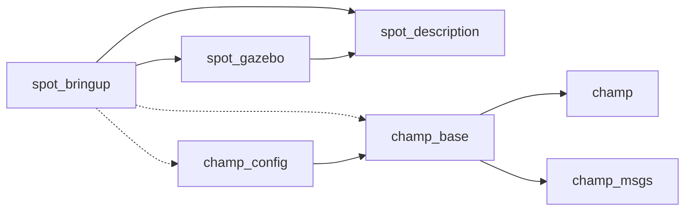
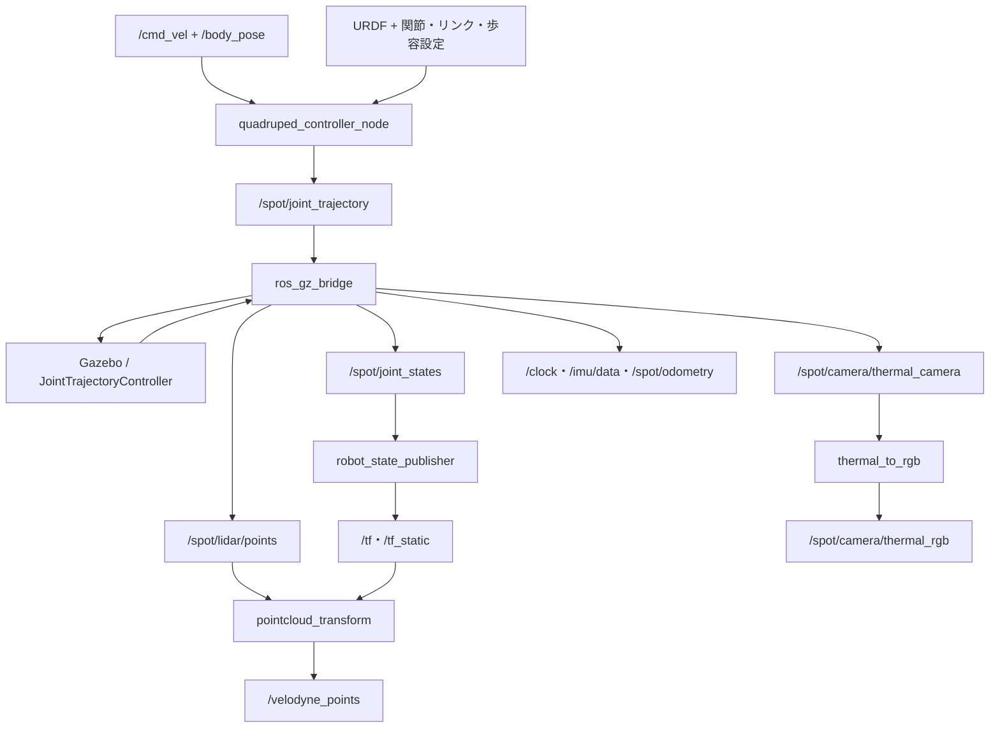

# spot_gazebo_ros2：依存関係と主要ロジック

> この文書はJazzy移行前の静的解析記録です。移行後の変更点・環境設定・GUI動作確認は[移行とデモの記録](docs/JAZZY_WALL_DEMO.md)を参照してください。

## 1. 対象と目的

対象は本リポジトリ全体（7つのROS 2パッケージ）。本書でいうビジネスロジックは、Spotの歩行指令、シミュレーション、センサー処理、状態推定、および外部ナビゲーション機能との接続を指す。

`package.xml`、`CMakeLists.txt`、launch、設定、C++／Python実装を静的に確認して抽出した。ビルド・シミュレーションによる動作確認は行っていない。外部パッケージの内部アルゴリズムは本リポジトリから確認できないため、起動設定で確認できる範囲を記載する。

[README](README.md)に記載された対象環境はUbuntu 22.04、ROS 2 Humble、Gazebo Fortress。ビルドは`colcon`と`ament_cmake`を使用する。

## 2. パッケージ構成

| パッケージ | 責務 | 主な成果物・入口 |
|---|---|---|
| `champ` | 四脚モデル、姿勢制御、歩容生成、逆運動学、脚オドメトリ | [コアヘッダー](champ/include/champ)、[CMake](champ/CMakeLists.txt)。主にヘッダーライブラリ |
| `champ_base` | CHAMPをROS 2ノードとして実行 | [quadruped_controller](champ_base/src/quadruped_controller.cpp)、[state_estimation](champ_base/src/state_estimation.cpp)、[message_relay](champ_base/src/message_relay.cpp) |
| `champ_config` | Spot用の歩容、関節順序、リンク対応 | [gait](champ_config/config/gait/gait.yaml)、[joints](champ_config/config/joints/joints.yaml)、[links](champ_config/config/links/links.yaml) |
| `champ_msgs` | CHAMP固有の通信型 | [9種のメッセージ定義](champ_msgs/msg)、[生成設定](champ_msgs/CMakeLists.txt) |
| `spot_bringup` | 起動構成、ROS–Gazebo接続、点群・熱画像変換、外部機能の接続 | [標準launch](spot_bringup/launch/spot.gazebo.launch.py)、[点群処理](spot_bringup/src/pointcloud_transform.cpp)、[画像処理](spot_bringup/scripts/thermal_to_rgb.py) |
| `spot_description` | ロボット形状、関節、センサー、Gazebo制御プラグイン設定 | [URDF](spot_description/models/spot/model.urdf)、[SDF](spot_description/models/spot/model.sdf) |
| `spot_gazebo` | ワールドとGazeboリソース検索パス | [worlds](spot_gazebo/worlds)、[環境フック](spot_gazebo/hooks) |

## 3. 依存関係

### 3.1 内部パッケージの関係

矢印は「依存する側 → 利用する側」。実線は`package.xml`の宣言、破線はlaunchからの参照。

根拠：[champ_base/package.xml](champ_base/package.xml)、[champ_config/package.xml](champ_config/package.xml)、[spot_bringup/package.xml](spot_bringup/package.xml)、[spot_gazebo/package.xml](spot_gazebo/package.xml)、[標準launch](spot_bringup/launch/spot.gazebo.launch.py)。

### 3.2 ビルド・コード上の外部依存

| 利用箇所 | 依存 | 用途・宣言状況 |
|---|---|---|
| 全パッケージ | `ament_cmake` | 全CMakeで要求。一部の`package.xml`には`buildtool_depend`がない |
| `champ` | `rclcpp`、`urdf` | CMakeで`rclcpp`を要求。URDFユーティリティで`urdf/model.h`を使用するが、両者とも[manifest](champ/package.xml)に依存宣言がない |
| `champ_base` | `rclcpp`、`rclpy`、`visualization_msgs`、`geometry_msgs`、`sensor_msgs`、`trajectory_msgs`、`nav_msgs`、`tf2_ros`、`urdf`、`message_filters` | [manifest](champ_base/package.xml)と[CMake](champ_base/CMakeLists.txt)で宣言。`tf2`のヘッダーも直接使用するが、`tf2`自体の明示宣言はない |
| `champ_msgs` | `rosidl_default_generators`、`rosidl_default_runtime`、`std_msgs`、`geometry_msgs`、`builtin_interfaces`、`common_interfaces` | [manifest](champ_msgs/package.xml)で生成・実行用依存を宣言。CMakeのメッセージ生成依存は`std_msgs`と`geometry_msgs` |
| `spot_bringup`のC++ | `rclcpp`、`sensor_msgs`、`tf2_ros`、`tf2_sensor_msgs`、`geometry_msgs`、`pcl_conversions`、PCL | [manifest](spot_bringup/package.xml)と[CMake](spot_bringup/CMakeLists.txt)を参照。PCLはCMakeで必須検索するが、点群変換実装はROSのイテレーターとTF2を使用 |
| `spot_bringup`のPython | `rclpy`、`cv_bridge`、OpenCV（`cv2`）、NumPy | [thermal_to_rgb.py](spot_bringup/scripts/thermal_to_rgb.py)でimport。`rclpy`と`cv_bridge`は宣言済み。OpenCVとNumPyの直接宣言はなく、NumPyはimportのみ |
| launch | `launch`、`launch_ros`、`ament_index_python` | Python起動構成で使用。`spot_bringup/package.xml`に直接の依存宣言がない |
| lint | `ament_lint_auto`、一部で`ament_lint_common` | `BUILD_TESTING`時の設定あり。確認した範囲では独立した機能テストはない |

### 3.3 標準シミュレーションの実行時依存

| 依存 | 用途 |
|---|---|
| `ros_gz_sim` | Gazebo起動用launchの読み込み |
| `ros_gz_bridge` | `parameter_bridge`によるメッセージ変換。manifestには上位パッケージ`ros_gz`を宣言 |
| `robot_state_publisher` | ロボット記述と関節状態からリンクのTFを配信 |
| `rviz2` | `rviz:=true`の場合に可視化 |
| Gazebo標準プラグイン | 物理、センサー、IMU、関節状態、オドメトリ、関節軌道制御など |
| Gazebo Fuel上のモデル | ワールド内のトンネル、鉱山、設備等。リモートURIを含み、利用時には取得済みキャッシュまたはアクセス可能な配信元が必要 |

根拠：[標準launch](spot_bringup/launch/spot.gazebo.launch.py)、[bridge設定](spot_bringup/config/spot_bridge.yaml)、[モデルSDF](spot_description/models/spot/model.sdf)、[ワールド](spot_gazebo/worlds)。`robot_state_publisher`と`rviz2`は`spot_bringup/package.xml`に直接の宣言がない。

### 3.4 追加機能の実行時依存

以下は標準launchでは起動しない。外部パッケージの実装は本リポジトリに含まれず、`spot_bringup/package.xml`にも直接宣言されていない。

| 起動ファイル | 必要な外部パッケージ | 組み立てる処理 |
|---|---|---|
| [dlo.launch.py](spot_bringup/launch/dlo.launch.py) | `direct_lidar_odometry` | 点群・IMUからのオドメトリノード起動 |
| [dlo.mapping.launch.py](spot_bringup/launch/dlo.mapping.launch.py) | `direct_lidar_odometry` | オドメトリとキーフレームによるマッピング。外部パッケージ内の設定も参照 |
| [dlo.localization.launch.py](spot_bringup/launch/dlo.localization.launch.py) | `direct_lidar_odometry` | DLO起動とPCD地図を使う自己位置推定 |
| [fast_lio_sim.launch.py](spot_bringup/launch/fast_lio_sim.launch.py) | `fast_lio` | FAST-LIOマッピング、PCD保存を有効化。`/Odometry`を`/odometry_lio`へ変更 |
| [lio_localization.launch.py](spot_bringup/launch/lio_localization.launch.py) | `fast_lio`、`terrain_analysis`、`ndt_localization` | FAST-LIO、地形処理、既存PCD地図に対するNDT自己位置推定を起動 |
| [planner.launch.py](spot_bringup/launch/planner.launch.py) | `local_planner_motion_primitives` | 局所プランナーとPure Pursuit追従器を起動 |
| [local_planner.launch.py](spot_bringup/launch/local_planner.launch.py) | `mpl_planner` | 点群マップ、局所計画、速度調整付きPure Pursuitを起動 |
| [far_planner.launch.py](spot_bringup/launch/far_planner.launch.py) | `far_planner`、`graph_decoder`、`spot_navigation`、`mpl_planner` | FAR経路計画、地図読込、目標マーカー、経路追従を起動 |

## 4. 標準起動時のデータフロー

入口：`ros2 launch spot_bringup spot.gazebo.launch.py`。既定のワールドは`simple_tunnel.sdf`、RVizは無効、起動するROSノードには`use_sim_time=true`を設定する。

| ROSトピック | メッセージ型 | 主な役割 |
|---|---|---|
| `/cmd_vel` | `geometry_msgs/msg/Twist` | 歩行速度。ノード内の`cmd_vel/smooth`からremap |
| `/body_pose` | `geometry_msgs/msg/Pose` | 胴体の位置・姿勢指令 |
| `/spot/joint_trajectory` | `trajectory_msgs/msg/JointTrajectory` | 12関節の位置目標をGazeboへ送信 |
| `/spot/joint_states` | `sensor_msgs/msg/JointState` | Gazeboからの関節状態 |
| `/spot/odometry` | `nav_msgs/msg/Odometry` | Gazebo側のオドメトリ。CHAMPの脚推定とは別系統 |
| `/imu/data` | `sensor_msgs/msg/Imu` | Gazebo IMUの出力 |
| `/spot/lidar/scan`、`/spot/lidar/points` | `sensor_msgs/msg/LaserScan`、`sensor_msgs/msg/PointCloud2` | LiDAR出力 |
| `/velodyne_points` | `sensor_msgs/msg/PointCloud2` | フィールド補完・座標変換後の点群 |
| `/spot/camera/thermal_camera`、`/spot/camera/thermal_rgb` | `sensor_msgs/msg/Image` | 熱画像と疑似カラー画像 |
| `/clock` | `rosgraph_msgs/msg/Clock` | シミュレーション時刻 |

`state_estimation_node`と`message_relay_node`はビルドされるが、標準launchには含まれない。Gazeboからの関節状態は可視化側へ流れ、`quadruped_controller_node`自身は関節状態・IMUを購読しない。関節位置を追従させる処理はGazeboの`JointTrajectoryController`が担当する。

## 5. 主要なビジネスロジック

### 5.1 歩行指令から関節目標への変換

入口：[QuadrupedController](champ_base/src/quadruped_controller.cpp)の`controlLoop_()`。

1. **初期化**：歩容設定を取得し、URDFから脚のリンク寸法を読み込む。関節名は「左前・右前・左後・右後」の順で各脚3個、計12個を使用する。胴体高さの初期値は`nominal_height`。
2. **指令更新**：速度指令の`linear.x`、`linear.y`、`angular.z`を保存する。姿勢指令のQuaternionをroll/pitch/yawに変換し、Z位置には`nominal_height`を加算する。
3. **胴体姿勢の補正**：[BodyController::poseCommand](champ/include/champ/body_controller/body_controller.h)が基準足先位置に胴体指令の逆方向の平行移動・回転を適用し、股関節座標系へ変換する。Z方向の移動量には脚長に基づく制限がある。
4. **速度制限と歩幅計算**：[LegController::velocityCommand](champ/include/champ/leg_controller/leg_controller.h)が速度を設定上限に制限する。並進の半歩分は`stance_duration / 2 × target_velocity`で求め、旋回分を加えて各脚の歩幅と軌道方向を決める。
5. **接地・遊脚の位相生成**：[PhaseGenerator::run](champ/include/champ/leg_controller/phase_generator.h)が対角脚を同位相とする周期を生成する。左前・右後に対し、右前・左後を半周期ずらす。接地時間は設定値、遊脚時間はコード内で0.25秒固定。速度ゼロでは位相信号をリセットする。
6. **足先軌道生成**：[TrajectoryPlanner::generate](champ/include/champ/leg_controller/trajectory_planner.h)が、接地中は直線移動と余弦によるZ補正、遊脚中は12制御点の11次Bezier曲線を使う。歩幅ゼロなら歩行用の足先変位を加えず、接地位相とする。
7. **逆運動学**：[Kinematics::inverse](champ/include/champ/kinematics/kinematics.h)が4脚の足先目標を各3関節の角度に変換する。リンク長と膝の曲がる方向を使い、到達距離・NaNの確認を行う。失敗時の制約は後述。
8. **送信**：12個の位置を1点の`JointTrajectory`として配信する。`time_from_start`は1/60秒、ヘッダー時刻はゼロに設定する。

制御タイマーの既定値は200 Hz（5 ms）で、実装はwall timerを使用する。一方、歩容計算の時刻はROS clockからマイクロ秒に変換する。標準launchでは関節制御出力のみ有効で、CHAMP側からの関節状態・接地状態の配信は無効。

### 5.2 ロボット形状と歩容設定

[URDFローダー](champ/include/champ/utils/urdf_loader.h)は設定されたリンク列をたどり、関節原点の平行移動量から各脚の構造を設定する。[QuadrupedBase](champ/include/champ/quadruped_base/quadruped_base.h)が4脚を保持し、関節位置更新と足先位置取得を集約する。

| 設定 | 現在値 | 意味 |
|---|---|---|
| `max_linear_velocity_x` | 1.5 m/s | 前後方向の速度上限 |
| `max_linear_velocity_y` | 0.25 m/s | 左右方向の速度上限 |
| `max_angular_velocity_z` | 1.0 rad/s | 旋回速度上限 |
| `nominal_height` | 0.48 m | 基準胴体高さ |
| `stance_duration` | 0.4 s | 接地フェーズの長さ |
| `swing_height` | 0.1 m | 遊脚軌道の高さ |
| `stance_depth` | -0.01 m | 接地軌道のZ補正に使用する符号付き値 |
| `com_x_translation` | -0.05 m | 基準足先配置の前後補正 |
| `knee_orientation`、`pantograph_leg` | `>>`、`false` | 膝方向と脚機構の設定 |
| `odom_scaler` | 1.0 | 脚オドメトリの並進スケール |

根拠：[gait.yaml](champ_config/config/gait/gait.yaml)、[QuadrupedLeg](champ/include/champ/quadruped_base/quadruped_leg.h)。

### 5.3 Gazebo上の動作とセンサー接続

[モデルSDF](spot_description/models/spot/model.sdf)が関節軌道制御、関節状態、オドメトリ、IMUのプラグインを設定する。関節制御の設定値はP=500、I=1、D=20。関節状態は200 Hz、オドメトリは10 Hz、LiDARは10 Hz、IMUは100 Hz、熱カメラは30 Hzの設定。

[bridge設定](spot_bringup/config/spot_bridge.yaml)では、関節軌道だけをROS→Gazeboへ送り、時計・センサー・関節状態・オドメトリをGazebo→ROSへ送る。Gazeboのposeを`/tf`へ渡す設定はコメントアウトされている。モデルとワールドの探索パスは環境フックで追加する。

### 5.4 点群のフィールド補完と座標変換

入口：[PointCloudTransform::pointcloud_callback](spot_bringup/src/pointcloud_transform.cpp)。

1. 入力`frame_id`が空なら警告して破棄する。
2. `intensity`、`ring`、`time`がそろっていれば点群をコピーする。不足があれば`x/y/z/intensity/ring/time`の6フィールドを持つ点群を作る。
3. `intensity`がなければ0、`ring`がなければ仰角を設定視野角へ制限し、走査線番号に変換する。
4. 補完時の`time`は、方位角を0〜2πに変換して`方位角 / 2π / scan_rate`で計算する。これは走査モデルに基づく合成時刻である。
5. 点群時刻に対応するTFを最大0.1秒待ち、目標座標系へ変換して配信する。既に同じ座標系なら変換を省略する。TF例外時は警告して当該点群を配信しない。

標準launchは入力を`/spot/lidar/points`、出力を`/velodyne_points`、目標を`base_link`に設定する。走査条件は10 Hz、16本、垂直視野角±15度。入力QoSはBest Effort、出力はReliable。

補完分岐では、既存の`time`があっても再計算する。また、6フィールド以外の付加情報と元の点群の行列構造は保持しない。

### 5.5 熱画像の疑似カラー化

入口：[ThermalToRGB.image_callback](spot_bringup/scripts/thermal_to_rgb.py)。

`/spot/camera/thermal_camera`を`mono16`として読み、フレームごとの最小・最大値で0〜255に正規化する。OpenCVの`COLORMAP_INFERNO`を適用し、`bgr8`画像として`/spot/camera/thermal_rgb`へ配信する。時刻と`frame_id`は保持する。

これは可視化のための変換であり、フレームごとに色と温度値の対応が変わり得る。変換例外はログに記録する。入力QoSはBest Effort、出力はReliable。

### 5.6 脚状態からの自己状態推定（別途起動）

入口：[StateEstimation](champ_base/src/state_estimation.cpp)、[Odometry::getVelocities](champ/include/champ/odometry/odometry.h)。

- `joint_states`と`foot_contacts`をApproximateTimeで同期し、12関節の位置と4脚の接地状態を更新する。
- 接地脚の足先位置の時間変化から並進・旋回速度を計算し、`odom_scaler`と前回速度の重み0.1による平滑化を適用する。全脚接地または全脚非接地の場合は速度をゼロとする。
- 速度を位置・方位に積分し、`odom/raw`を配信する。接地脚の高さと配置から胴体姿勢を計算し、`base_to_footprint_pose`を配信する。両タイマーの設定は50 Hz。
- 3脚以上の接地では足先が作る平面を使う。2脚以下では接地脚の配置と、利用可能ならIMU姿勢を使う。接地ゼロでは全脚の高さを使う。
- 足先の可視化用`foot`マーカーは購読者がいる場合に配信する。

このノードの`urdf`パラメーターはXML文字列を受ける。歩行制御ノードの同名パラメーターはファイルパスを受けるため、設定をそのまま共用できない。

### 5.7 CHAMP固有メッセージの中継（別途起動）

入口：[MessageRelay](champ_base/src/message_relay.cpp)。

| 入力 | 出力・条件 |
|---|---|
| `imu/raw`：`champ_msgs/Imu` | `has_imu=true`なら`imu/data`と`imu/mag`。時刻・フレーム・固定共分散を付与 |
| `joint_states/raw`：`champ_msgs/Joints` | `gazebo=false`なら`joint_states`、`gazebo=true`なら`joint_group_position_controller/command`への関節軌道 |
| `foot_contacts/raw`：`champ_msgs/Contacts` | 時刻付き`champ_msgs/ContactsStamped`として`foot_contacts`へ配信 |

### 5.8 外部自己位置推定・経路計画の統合

このリポジトリが実装するのは、外部ノードの起動、パラメーター供給、トピック接続と終了処理である。

- **FAST-LIO系**：[共通設定](spot_bringup/config/lio_localization.yaml)は`/velodyne_points`と`/imu/data`を入力に指定する。マッピング用launchはPCD保存を有効化し、自己位置推定用launchは保存を無効化して地形処理・NDTノードを追加する。
- **DLO系**：オドメトリ、マッピング、既存地図での自己位置推定を別のlaunchで構成する。`dlo.launch.py`と`dlo.localization.launch.py`は主要ノード終了時にlaunch全体を終了するイベントを登録する。
- **局所経路計画**：`local_planner.launch.py`は地図サーバー・局所プランナー・追従器を起動し、終了時に`/cmd_vel`へゼロ速度を1回送信する処理を登録する。
- **FAR系**：`/odometry_lio`と`/terrain_cloud`を接続し、`/far_path`を追従器の入力へ割り当てる。既定では5秒後に`/read_file_dir`へ地図パスを1回配信する。追従器には先読み0.5 m、速度0.5 m/s、目標許容距離0.3 m、角速度上限1.0 rad/sなどを設定する。

## 6. 抽出時に確認した接続条件・実装上の制約

以下は静的なコード確認に基づく。実行時の発生確認や修正は本書の対象に含めない。

| 項目 | 確認内容と影響 | 根拠 |
|---|---|---|
| 依存宣言の不足 | launchの参照先や一部の直接importがmanifestにない。manifestベースの依存解決だけで全機能がそろうとは限らない | 本書3章の各manifestとlaunch |
| DLO系のトピック不一致 | 標準起動は点群を`/velodyne_points`、IMUを`/imu/data`へ出力する。一方DLOの既定値は`/spot/lidar/points_base`や`/spot/imu`。局所プランナーも`points_base`を参照する | [標準launch](spot_bringup/launch/spot.gazebo.launch.py)、[bridge](spot_bringup/config/spot_bridge.yaml)、[DLO](spot_bringup/launch/dlo.launch.py)、[局所プランナー](spot_bringup/launch/local_planner.launch.py) |
| モデル記述の入力形式 | `robot_state_publisher`には`model.sdf`の内容を`robot_description`として渡し、CHAMPには`model.urdf`のパスを渡している。前者の読込可否は実行環境で確認が必要 | [標準launch](spot_bringup/launch/spot.gazebo.launch.py) |
| 追加機能の未同梱ファイル | FARの既定地図`maps/simple_tunnel.vgh`、LIOのRViz設定`rviz/lio_localization.rviz`がリポジトリにない。PCD地図`maps/simple_tunnel.pcd`は存在する | [FAR launch](spot_bringup/launch/far_planner.launch.py)、[LIO launch](spot_bringup/launch/lio_localization.launch.py) |
| 逆運動学の失敗処理 | 到達不能・NaN時に早期returnするが、呼び出し元の目標角度配列は未初期化で、成功判定や送信抑止がない。失敗時に有効な目標値が保証されない | [逆運動学](champ/include/champ/kinematics/kinematics.h)、[controlLoop_](champ_base/src/quadruped_controller.cpp) |
| 指令の有効期限 | 最後の速度指令を保持し続ける。歩行制御ノード内に指令タイムアウトによる停止処理はない | [速度コールバックと制御ループ](champ_base/src/quadruped_controller.cpp) |
| 脚オドメトリの積分 | 時間差が`nanoseconds() / 1e-9`になっており、秒への変換と一致しない。また積分状態`x_pos_`、`y_pos_`、`heading_`の明示初期化がない。標準launchでは当該ノードは起動しない | [state_estimation.cpp](champ_base/src/state_estimation.cpp)、[ヘッダー](champ_base/include/state_estimation.h) |

## 7. ロジック変更時の主な参照先

| 変更したい内容 | 主な参照先 |
|---|---|
| 歩行速度・高さ・歩容調整 | `champ_config/config/gait/gait.yaml` |
| 関節順序・機体寸法 | `champ_config/config/{joints,links}`、`spot_description/models/spot/model.urdf` |
| 歩幅・接地周期・遊脚軌道 | `champ/include/champ/leg_controller` |
| 姿勢指令・関節指令の入出力 | `champ_base/src/quadruped_controller.cpp` |
| Gazebo内の関節追従・センサー | `spot_description/models/spot/model.sdf` |
| ROS–Gazeboのトピック接続 | `spot_bringup/config/spot_bridge.yaml` |
| 点群形式・座標系 | `spot_bringup/src/pointcloud_transform.cpp`と標準launch |
| 自己位置推定・経路計画との接続 | `spot_bringup/launch`、`spot_bringup/config` |
