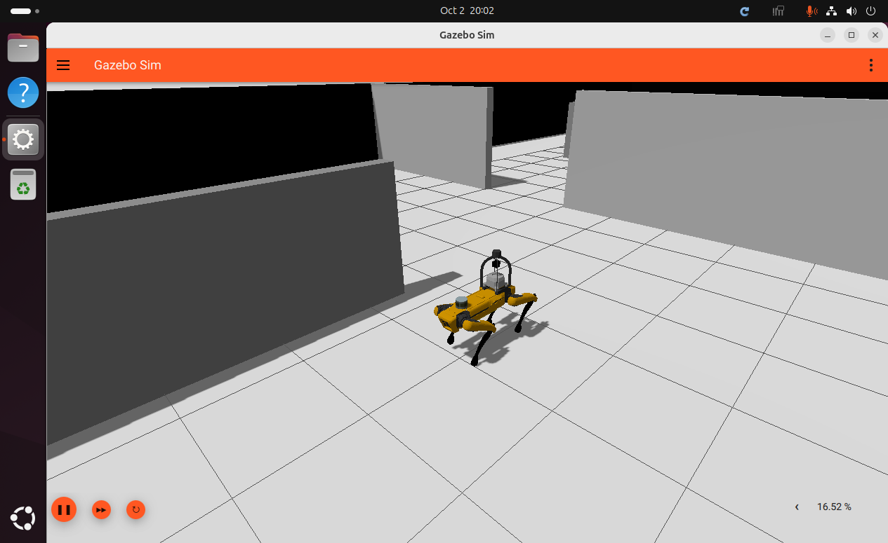
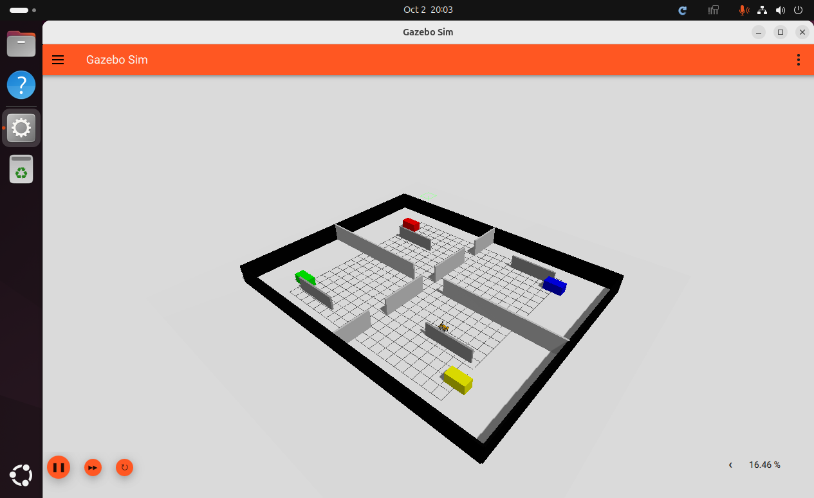

# ROS 2 Jazzy / Gazebo Harmonicへの移行とwall_demo

## 確認環境

2026-10-02、ブランチ`champ`上で変更・実行した。新しいブランチは作成していない。

| 項目 | 確認値 |
|---|---|
| OS | Ubuntu 24.04.5 LTS、x86_64 |
| ROS | `/opt/ros/jazzy/setup.zsh`、`ROS_DISTRO=jazzy` |
| Gazebo | Gazebo Sim 8.15.0（Harmonic） |
| GPU | NVIDIA GeForce RTX 3090 |
| GUI | NoMachine、`DISPLAY=:1001`、1265 × 775 |
| 通信分離 | このデモの既定値は`ROS_DOMAIN_ID=71`、`GZ_PARTITION=spot_gazebo_jazzy` |

JazzyとHarmonicの組み合わせは[ros_gzの対応表](https://github.com/gazebosim/ros_gz)に対応する。
名称の更新は[Gazebo移行ガイド](https://gazebosim.org/docs/harmonic/migration_from_ignition/)に従う。

## 変更内容

- SDFの`ignition-gazebo-*`、`ignition::gazebo::systems`を`gz-sim-*`、`gz::sim::systems`へ更新。
- bridgeの通信型を`gz.msgs.*`へ更新。
- 環境フックを`GZ_SIM_RESOURCE_PATH`、`GZ_SIM_SYSTEM_PLUGIN_PATH`へ更新。Spotの`package://`参照を解決できる`share`ディレクトリを登録。
- `robot_state_publisher`にURDFを渡すよう修正。URDFのメッシュパスを実際の配置に合わせ、LiDAR・IMU・熱カメラの固定TFを追加。
- IMUと熱カメラのGazebo出力フレーム名を設定。旧`alwaysOn`と熱センサー内の不要な`geometry`要素を整理。
- 必要なament、TF2、launch、CHAMP、ROS–Gazebo、画像処理の依存宣言を補完。未使用のPCLビルド依存を除去。
- 熱画像Pythonノードをlaunch自身と同じPythonで起動し、Homebrew Pythonへの切替による`yaml` import失敗を回避。
- シミュレーションを`-r`で開始。ワールド引数は同梱ファイル名または絶対パスに対応。
- [wall_demo.sdf](../spot_gazebo/worlds/wall_demo.sdf)、環境設定、短時間の歩行検証スクリプトを追加。

## ワールドの出典と変更

出典は[liudazhi / wall_demo](https://app.gazebosim.org/liudazhi/fuel/worlds/wall_demo)、Fuelのバージョン1（`warehouse_world.sdf`）。
倉庫の床、壁、障害物、色付き棚の形状・配置は保持している。

Spotを`(x, y, z) = (3, -4, 0.75)`に追加し、物理ステップを1 msに設定した。GPU LiDAR・熱カメラを扱うためSensorsプラグインのレンダラーを`ogre2`へ変更し、GUIカメラと操作・統計表示を追加した。ワールド名は`warehouse_world`。

## 環境設定とビルド

以下はリポジトリ直下から実行する。

通常のROS環境では、依存関係をrosdepで導入する。

```zsh
source /opt/ros/jazzy/setup.zsh
rosdep install --from-paths champ champ_base champ_config champ_msgs spot_bringup spot_description spot_gazebo --ignore-src -r -y --rosdistro jazzy
```

今回のホストではsudoにパスワードが必要だったため、不足する小さなROS開発パッケージを公式APTから取得し、ワークスペース内の`.ros-deps`へ展開した。この方法を再現する場合は、上のrosdep導入に代えて次を実行する。

```zsh
bash scripts/install_local_dependencies.sh
```

この補助スクリプトは、既にJazzyと`ros_gz`等が導入されている今回のホスト向けであり、ROS全体のインストーラーではない。システムの`/opt/ros/jazzy`は変更しない。

```zsh
source scripts/setup.zsh
export DISPLAY=:1001
colcon build --symlink-install --parallel-workers 4 --cmake-args -DCMAKE_BUILD_TYPE=RelWithDebInfo -DBUILD_TESTING=OFF -DPython3_EXECUTABLE=/usr/bin/python3
source scripts/setup.zsh
```

`setup.zsh`はROS Jazzy、存在する場合はローカル依存、ワークスペースのoverlayを読み込み、`DISPLAY=:1001`を設定する。`ROS_DOMAIN_ID`と`GZ_PARTITION`は未設定時のみ上表の値を使う。既存の別シミュレーションと混線させないため、起動・操作する各ターミナルで同じ設定を使う。

## GUIの起動と歩行確認

```zsh
source scripts/setup.zsh
export DISPLAY=:1001
ros2 launch spot_bringup spot.gazebo.launch.py world_file:=wall_demo.sdf
```

初回はワールドが参照するSunモデルのダウンロードが必要になる場合がある。事前取得も可能。

```zsh
gz fuel download -u https://fuel.gazebosim.org/1.0/OpenRobotics/models/Sun
```

別ターミナルで次を実行する。

```zsh
source scripts/setup.zsh
export DISPLAY=:1001
/usr/bin/python3 scripts/walk_demo.py --capture
```

スクリプトはセンサー配信を待ち、前進速度0.25 m/sをシミュレーション時間で6秒間配信して停止する。移動量、胴体姿勢、点群形式、熱画像形式を確認し、`.cache/wall_demo/verification.json`を出力する。`--capture`はGazeboのカメラ位置を変え、NoMachineの実画面をPNG保存する（`/usr/bin/import`が必要）。保存先は`--output`で変更できる。

障害物回避や自律ナビゲーションは行わない。最初の空いた配置から実行し、繰り返す際はワールドを再起動して位置を戻す。テスト中の姿勢異常やタイムアウトでは終了処理でゼロ速度を配信する。

## 実測結果

全7パッケージのビルドが完了した。GUI起動後、速度指令→CHAMP→ROS–Gazebo bridge→Gazebo関節制御→物理移動までを確認した。

以下は表示が正常なNoMachine GUIで行った最終歩行検証の値。

| 項目 | 結果 |
|---|---|
| 前進指令 | 0.25 m/s × 6秒（シミュレーション時間） |
| 実測移動距離 | 1.189 m |
| 開始位置 | (4.215, -4.005, 0.481) m |
| 終了位置 | (5.404, -4.021, 0.479) m |
| 最大roll絶対値 | 1.24度 |
| 最大pitch絶対値 | 0.97度 |
| 関節状態 / IMU受信数 | 1385 / 695 |
| 点群 / 熱画像受信数 | 63 / 213 |
| 点群 | `base_link`、`x/y/z/intensity/ring/time` |
| 熱画像 | `bgr8` |
| 検証判定 | PASS |

最終撮影は同じ空いた通路で2回目の歩行を行ったため、開始X座標が初期spawn位置より前にある。根拠となる全数値は[verification.json](../assets/wall_demo/verification.json)に保存した。

### 歩行中の実画面



### wall_demo全景



## 検証の範囲と環境上の制約

- XML・Pythonの構文、全URDFメッシュの存在、12関節名、bridge通信型の整合性を確認した。
- 今回のビルドでは`BUILD_TESTING=OFF`を使用し、既存コード全体のlintは実施していない。上記の実シミュレーション検証を実施した。
- NoMachineで通常起動するとGUIは表示されるが、描画はMesa llvmpipeへフォールバックし、実時間係数は撮影時およそ0.16〜0.18だった。6秒のシミュレーションには実時間で約35〜40秒かかる。
- NoMachine付属VirtualGLでNVIDIAを使う方法も試したが、この環境ではGUIの3D領域が空白になった。掲載画像と最終検証は、正常表示を確認した通常起動で行った。
- ログに出る`gz_frame_id`のSDFormat拡張要素警告、KDLのルート慣性警告、および利用権限のないDRIデバイスへのEGL警告は残る。上記トピック配信と歩行は確認済み。
- DLO、FAST-LIO、FAR等の外部ナビゲーションパッケージは今回の実行検証に含めていない。
